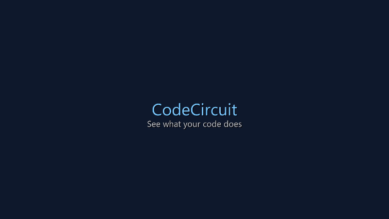

# Kod Sirkuit — Code Circuit Board Visualizer

**Try it live:** [kod-sirkuit demo](https://fineraystudio.github.io/kod-sirkuit/) (coming soon)

Turn any GitHub repo into a circuit board you can explore. Every file becomes a chip, every import a wire — and light shows how the program flows.

## 🎮 Try the Demos

Three live examples to explore:

1. **2048 Game** — See how tile movement, merging, and win/lose logic flows
2. **Snake Game** — Watch the game loop, collision detection, and snake growth
3. **TodoMVC** — Explore CRUD operations, filtering, and state management

Each demo loads the real repo from GitHub and visualizes its code structure.

## ✨ Features

### 🔌 Board View
Every file is a chip on a circuit board. Click a chip to light up its connections:
- **Amber arrows** → what it uses
- **Teal arrows** → what uses it
- **⚡ Power on** lights up everything reachable from the entry point

### 🎯 Flow View  
Double-click a chip to play through a function like a game:
- The light walks through each line
- Every **decision stops** and waits for you to choose
- See the code, logic, variables, and outside effects in sync
- **Paths you've tried stay lit** — explore them all

### 🔍 What It Shows
- **Circuit board:** file connections, dependencies, dead code
- **Flow game:** function logic, decisions, variable state
- **Outside world:** what the code touches (screen, storage, network, logs)

## 🚀 How to Use

1. Visit the [demo site](https://fineraystudio.github.io/kod-sirkuit/)
2. Click one of the demo cards to load a repo
3. Explore the circuit board (zoom, pan, click chips)
4. Double-click a chip to enter Flow View
5. Press **Start** to walk through the function

Or paste any GitHub repo URL in the input box to visualize your own code.

## 🛠️ About

**Kod Sirkuit** is a demo-only version of [CodeCircuit](https://github.com/faridrameli/code-visualizer), built to showcase code visualization in action. 

- **No installation needed** — runs entirely in your browser
- **No server required** — fetches repos directly from GitHub
- **Privacy first** — your code stays on GitHub, nothing is sent elsewhere

### Why "Kod Sirkuit"?

"Kod" (code) + "Sirkuit" (circuit) in Bahasa Melayu/Indonesia. This demo makes code visualization accessible to developers learning in their native language.

## 📝 License

This demo is based on [CodeCircuit](https://github.com/faridrameli/code-visualizer), MIT licensed.

The demo repos are also MIT licensed:
- [2048](https://github.com/gabrielecirulli/2048) by Gabriele Cirulli
- [Snake](https://github.com/taniarascia/snek) by Tania Rascia  
- [TodoMVC](https://github.com/1Marc/modern-todomvc-vanillajs) by Marc

## 🔗 Links

- [Live Demo](https://fineraystudio.github.io/kod-sirkuit/) (coming soon)
- [Full CodeCircuit Tool](https://github.com/faridrameli/code-visualizer)
- [Report Issues](https://github.com/fineraystudio/kod-sirkuit/issues)

---

Built with ❤️ to make code easier to understand
